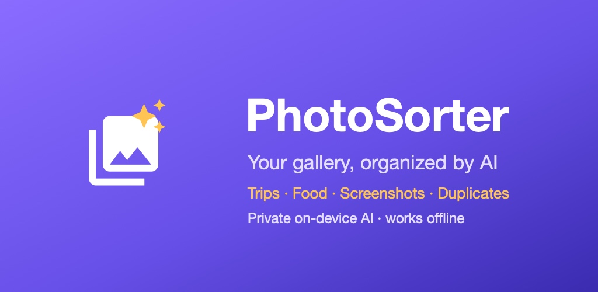

# PhotoSorter for Android



An Android app that organizes your photo gallery with a vision-language model running **on the
phone**: trips, food, screenshots, people and more, plus a fast duplicate finder. Built with
Kotlin, Jetpack Compose and llama.cpp (C++ via JNI).

- **Organize** — files photos into folders under `Pictures/PhotoSorter/`. Trips are detected from
  the EXIF time-zone offset (and GPS when present), so every photo from a trip lands in one folder
  like `japan-trip`, food and people shots included.
- **Sort & describe** — copies each photo into a topic folder with a one-line AI caption.
- **Duplicates** — scans a 20,000+ photo library in under 2 minutes; keeps originals, never
  auto-selects RAW files, and sends removals to Android's 30-day trash.
- **Private by default** — on-device AI (Qwen3-VL-2B) works offline. Google Gemini is an optional
  cloud mode with your own API key, used only after an in-app consent.
- **Runs in the background** — foreground service with a progress notification and a Stop button;
  per-photo progress bars driven by a lock-free counter in the C++ inference layer.

## How Organize decides

1. Screenshots and WhatsApp images are recognized from where they are saved (no AI call).
2. For every other photo the model reports its **type** (food, people, pets, documents, nature,
   city, shopping, events, art, travel, other) and, only for clear travel shots, the **country**.
3. Photos taken in a different time zone than the phone's home zone at that date (or with a GPS
   country different from home) form runs split by gaps over 2 days. Each run becomes a trip,
   named by vote from GPS lookups and the model's place answers (`japan-trip`), else by month
   (`trip-sep-2026`).
4. Everything else goes to its type folder. You review the folders, then **Copy** (originals stay)
   or **Move** (each copy is size-verified, then the originals go to the trash after one system
   confirmation).

Folder rules live in `SmartFolders` ([Trips.kt](app/src/main/java/com/adityabalagere/photosorter/Trips.kt))
and are covered by unit tests.

## AI engines

| Engine | Use | Notes |
|---|---|---|
| Qwen3-VL-2B via llama.cpp (Standard) | Subjects, places, captions, fully offline | ~1.6 GB download in-app; ~15 s per photo on a Galaxy S24 Ultra; Apache 2.0 |
| SmolVLM2-500M via llama.cpp (Lite) | Captions; folder type from caption keywords | ~550 MB, about 3x faster; default on phones under 6 GB RAM; no landmark-based trip names; Apache 2.0 |
| MediaPipe EfficientNet-Lite0 (bundled) | Fallback categories when the model isn't downloaded | No place names |
| Google Gemini (optional) | Cloud captions, can web-verify landmarks | Your API key; photos are uploaded (downscaled) |

`native/vlm/compare_vlm.cpp` is a host-side A/B harness that runs any two GGUF models on the same
photos with the app's exact prompts. It was used to choose Qwen3-VL-2B (2.2x faster than
Qwen2.5-VL-3B, half the download, and a commercial-friendly license) and to tune the Lite prompt:
SmolVLM2-500M ignores a fixed answer format but writes accurate one-line captions, so the app
asks for a caption and maps its keywords to a folder type.

The model choice lives in AI settings (Standard / Lite), with the phone's RAM and a
recommendation shown. Prompts are wrapped in each model's own chat template.

## Build

Requirements: Android Studio (or JDK 17+), Android SDK 36, NDK 29, CMake 3.22, an arm64 device
(Android 8.0+).

```bash
git clone --recursive https://github.com/adityabp721/Photosorter-for-Android.git
cd Photosorter-for-Android
./gradlew testDebugUnitTest      # unit tests
./gradlew assembleDebug          # debug APK
./gradlew bundleRelease          # release bundle (signed if keystore.properties exists)
```

Already cloned without `--recursive`? Run `git submodule update --init` (fetches the pinned
llama.cpp). The native code is always built optimized: at the Debug default (-O0) one photo took
minutes instead of seconds.

To skip the in-app model download during development, push the files with adb:

```bash
adb push Qwen3VL-2B-Instruct-Q4_K_M.gguf      /sdcard/Android/data/com.adityabalagere.photosorter/files/llm/
adb push mmproj-Qwen3VL-2B-Instruct-Q8_0.gguf /sdcard/Android/data/com.adityabalagere.photosorter/files/llm/
# from https://huggingface.co/Qwen/Qwen3-VL-2B-Instruct-GGUF
# Lite: SmolVLM2-500M-Video-Instruct-Q8_0.gguf + mmproj-SmolVLM2-500M-Video-Instruct-Q8_0.gguf
#       from https://huggingface.co/ggml-org/SmolVLM2-500M-Video-Instruct-GGUF
```

Open the app once before pushing so it creates the `llm/` folder itself; a folder created by
`adb shell mkdir` is owned by the shell user and the app cannot read files in it.

## Project layout

```
app/src/main/java/com/adityabalagere/photosorter/
  PhotoSorterApp.kt   one AppModel per process, so jobs survive the activity
  AppModel.kt         state, permissions, worker pool, per-photo progress, copy/move/trash flow
  WorkService.kt      foreground service (mediaProcessing / dataSync) + progress notification
  MainActivity.kt     scaffold, navigation, permission and delete-request launchers
  Screens.kt          Sort, Organize and Duplicates screens
  Components.kt       shared UI: job card, photo rows, AI settings sheet, welcome screen
  Trips.kt            SmartFolders (types, trips, folder rules) + grouping
  VlmAi.kt            on-device model: prompts, answer parsing, JNI calls
  Gemini.kt           optional cloud classification with retries and quota handling
  LocalAi.kt          MediaPipe fallback labeler
  Duplicates.kt       SHA-256 on same-size files + perceptual hash of thumbnails, keep rules
  Organizer.kt        copies into Pictures/PhotoSorter/, verification, filed-photo index
  PhotoRepo.kt, ImageTools.kt, Thumbs.kt, Notifications.kt, Theme.kt
app/src/main/cpp/vlm_jni.cpp   JNI bridge to llama.cpp + mtmd (progress counter, abort flag)
native/llama.cpp               llama.cpp, pinned as a git submodule
native/vlm/                    host test and A/B comparison tools
docs/                          privacy policy and Play Store kit
```

## Permissions

Photos and videos (whole library), photo locations (GPS for trips), notifications (progress).
With partial photo access the app only sees the photos you selected. See
[docs/privacy-policy.html](docs/privacy-policy.html) for what leaves the device and when.

## License

Apache License 2.0, see [LICENSE](LICENSE). Third-party components are listed in
[THIRD_PARTY_NOTICES.md](THIRD_PARTY_NOTICES.md).
